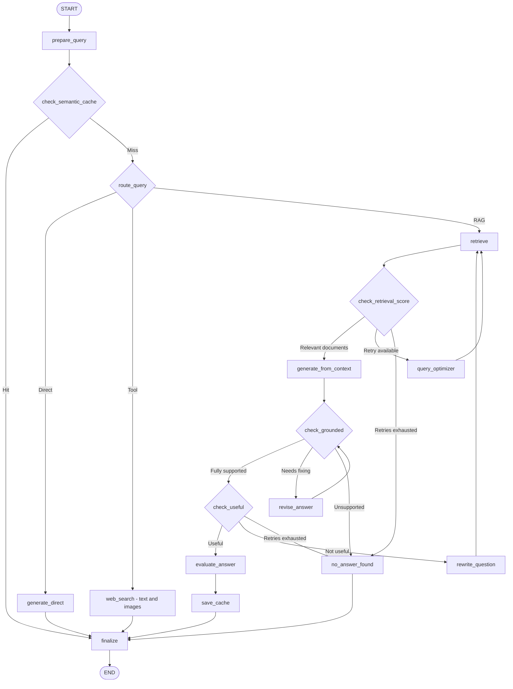

# LangGraph-DocuMind-AWS-Deployment

**LangGraph DocuMind** is an Advanced Self-Corrective Multimodal Retrieval-Augmented Generation (RAG) system that can answers questions over your own documents (text, tables and images from PDFs) and falls back to live web search when the question needs fresh information. It intelligently validates and refines doc-grounded answers through real-time state tracking, persistent chat history, and automated source citations.

A modular **Self-Corrective RAG (Retrieval-Augmented Generation)** system designed to answer questions using the right information source while continuously evaluating and improving its responses.

The system combines **LangGraph, LLMs, vector search, semantic caching, web search, answer evaluation, query rewriting, and persistent conversation memory** into a single end-to-end AI application.

---

<!-- <p align="center"> -->

[](https://www.python.org/)
[](https://www.langchain.com/langgraph)
[](https://streamlit.io/)
[](https://fastapi.tiangolo.com/)
[](https://www.pinecone.io/)
[](https://github.com/facebookresearch/faiss)
[](https://openai.com/)
[](https://aws.amazon.com/)
[](https://tavily.com/)
[](LICENSE)
[](https://github.com/Ahmed2797/LangGraph-DocuMind-AWS-Deployment)
[](https://www.docker.com/)
[](https://github.com/features/actions)
[](https://www.sqlite.org/)

<!-- </p> -->

---

## Features

- **Self-corrective RAG** — retrieved context is filtered, the answer is checked for groundedness (hallucination check) and usefulness, and the system revises the answer or rewrites the query when a check fails.
- **Smart routing** — each question goes to one of three paths: your documents (`rag`), live web search (`tool`), or a direct LLM answer (`direct`).
- **Multimodal** — PDFs are indexed as text chunks, markdown tables and page images. Answers come back with the matching images and tables attached. Users can also ask with an image; it is described by a vision model and used as part of the search query.
- **Web search with images** — Tavily (via MCP) returns text results plus images; the answer is written only from the search results and cited as `[1]`, `[2]`.
- **Multi-turn memory** — follow-ups such as "what about its price?" are rewritten into standalone questions using chat history; state is persisted with a SQLite checkpointer.
- **Semantic cache** — repeated or near-identical questions are answered instantly from a per-project Pinecone cache, with TTL expiry, automatic invalidation when documents change, and guards against near-miss matches ("revenue 2023" vs "revenue 2024").
- **Automatic evaluation** — hallucination, groundedness and overall quality scores for every RAG answer; only answers marked reliable are cached.
- **Production logging** — one JSON line per query with routing, retrieval, retries, cache, evaluation, latency and token metrics.
- **Multi-project** — every project has its own Pinecone namespace (or FAISS folder), image folder and cache namespace.

---

## Architecture



### Nodes

| Node | What it does |
|---|---|
| `prepare_query` | Resets all per-turn state, turns an uploaded image into a text description, and rewrites follow-up questions into standalone questions using chat history. |
| `check_semantic_cache` | Looks for a similar, fresh, same-project answer. Skipped for image queries and when `skip_cache` is set. |
| `route_query` | Classifies the question as `rag`, `tool` (web) or `direct`. Defaults to `rag` if the classifier fails. |
| `retrieve` | Vector search (`similarity_search_with_score`) followed by hybrid reranking (70% vector score, 30% keyword coverage). |
| `check_retrieval_score` | Keeps chunks that pass the vector threshold; rescues the best keyword match if none do. Handles both distance (FAISS/Chroma) and similarity (Pinecone) scores. |
| `query_optimizer` | Rewrites the query for retrieval (once) and loops back to `retrieve`. |
| `generate_from_context` | Answers from the retrieved chunks and attaches sources, citations, and images/tables found in those chunks. |
| `check_grounded` | Strict verifier: is every claim supported by the context? (`fully / partially / no support`) |
| `revise_answer` | Rewrites the answer as direct quotes from the context, then re-checks groundedness. |
| `check_useful` | Does the answer actually address the question? |
| `rewrite_question` | Rewrites the retrieval query and restarts retrieval with a fresh retry budget. |
| `evaluate_answer` | Computes hallucination, groundedness and overall quality metrics. |
| `save_cache` | Stores the answer (with sources, citations and media) in the semantic cache, only if marked reliable. |
| `web_search` | Tavily search with images, then an answer written strictly from the results. |
| `generate_direct` | Plain LLM answer for general knowledge questions. |
| `no_answer_found` | Safe fallback when nothing relevant or supported is found. |
| `finalize` | Appends the turn to chat history; every path ends here. |

---

## Tech stack

| Area | Technology |
|---|---|
| Orchestration | LangGraph, LangChain |
| LLM / embeddings | OpenAI (`text-embedding-3-small`, 1536 dimensions; chat model configurable) |
| Vector database | Pinecone (serverless) or FAISS (local) |
| Web search | Tavily through an MCP client |
| PDF extraction | pdfplumber (text, tables), PyMuPDF (images) |
| Conversation memory | LangGraph checkpointer with SQLite (`AsyncSqliteSaver`) |
| Observability | LangSmith tracing, structured JSON query logs |
| API (planned) | FastAPI with Server-Sent Events |

---

## Project structure

```bash
src/
├── chat_model.py            # cached ChatOpenAI / OpenAIEmbeddings clients
├── config.py                # settings (API keys, model names)
├── constants.py             # thresholds, paths, index names
├── exception.py, logger.py
├── mcp.py                   # Tavily MCP client (search_tool)
├── state.py                 # LangGraph State + structured-output models
├── vector.py                # create_embedding, Pinecone index helper
├── graph.py                 # create_graph(...)          <- create_graph.py
├── pipeline.py              # async context manager that builds the app per project
├── retrive/
│   ├── __init__.py          # get_project_retriever, index_files, delete_index
│   └── retrieval_pipeline.py# all graph nodes and routers
├── evalution/
│   └── evaluation_engine.py # answer evaluation metrics
└── monitoring/
    └── production_logger.py # JSON query logs
```

---

## Getting started

### 1. Install

```bash
git clone https://github.com/Ahmed2797/LangGraph-DocuMind-AWS-Deployment.git
cd LangGraph-DocuMind-AWS-Deployment
python -m venv .venv && source .venv/bin/activate
pip install -r requirements.txt
```

Main dependencies: `langgraph`, `langgraph-checkpoint-sqlite`, `aiosqlite`, `langchain`, `langchain-openai`, `langchain-pinecone`, `langchain-community`, `pinecone`, `faiss-cpu`, `pdfplumber`, `pymupdf`, `pandas`, `tabulate`, `langsmith`, plus MCP client library for Tavily.

### 2. Configure

Create a `.env` file (the variable names must match your `src/config.py`):

```env
OPENAI_API_KEY=sk-...
OPENAI_MODEL=gpt-4o-mini        # must support vision if you use image queries
PINECONE_API_KEY=...
PINECONE_INDEX_NAME=rag-docs     # leave empty to use local FAISS
TAVILY_API_KEY=tvly-...
LANGSMITH_API_KEY=...           # optional tracing
```

Use **two different Pinecone indexes**: one for documents, one for the semantic cache (`INDEX_NAME_CACHE_MEMORY` in `constants.py`). Both must be created with dimension `1536` and metric `cosine`; the code creates and validates them automatically on first use.

### 3. Index documents

```python
from src.retrive import index_files

index_files("my-project", ["reports/q3.pdf", "notes.txt"])
```

For every PDF this stores text chunks, markdown tables, and one image record per page (small icons and repeated logos are skipped). Re-uploading a file replaces its old chunks, and the project's semantic cache is cleared automatically.

### 4. Ask questions

```python
import asyncio
from src.pipeline import pipeline

async def main():
    async with pipeline("my-project") as app:
        config = {"configurable": {"thread_id": "my-project:chat-1"}}

        # Stream node-by-node (drives the animated workflow view)
        async for chunk in app.astream(
            {"question": "What was the revenue growth in Q3?"},
            config,
            stream_mode="updates",
        ):
            print(list(chunk.keys()))         # e.g. ['route_query'], ['retrieve'], ...

        state = (await app.aget_state(config)).values
        print(state["answer"])
        print(state["sources"], state["media"])

asyncio.run(main())
```

Notes:

- Use `ainvoke` / `astream` — the web search node is async.
- Use `thread_id = "<project>:<chat>"` so chats from different projects never share history.
- Only `question` (and optionally `query_image`, `skip_cache`) are needed as input. Everything else is reset automatically at the start of each turn.

**Ask with an image** (URL, data-URL or raw base64):

```python
await app.ainvoke({"question": "What does this chart show?", "query_image": image_b64}, config)
```

**Force a fresh answer** (a "regenerate" button):

```python
await app.ainvoke({"question": q, "skip_cache": True}, config)
```

---

## Response format

After a turn, the final state contains:

| Field | Description |
|---|---|
| `answer` | Final answer text |
| `sources` | Document names or web URLs used |
| `citations` | `[{source, page, snippet}]` |
| `media` | Images, charts and tables to display (see below) |
| `confidence_score` | Retrieval confidence adjusted by the groundedness verdict |
| `evaluation` | Hallucination, groundedness and quality metrics |
| `route` | `rag`, `tool` or `direct` |
| `cache_hit` | Whether the answer came from the semantic cache |

`media` items:

```json
{"type": "image", "url": "/images/my-project/p3_img_0_ab12cd.png", "source": "q3.pdf", "page": 3, "caption": ""}
{"type": "table", "content": "| Region | Revenue |\n|---|---|\n| EU | 1.2M |", "source": "q3.pdf", "page": 5}
{"type": "image", "url": "https://example.com/photo.jpg", "caption": "…", "source": "web"}
```

---

## Semantic cache

- Stored per project in a separate Pinecone index, namespace `cache-<project>`.
- A cached answer is returned only if it is in the same project, the same `CACHE_VERSION`, newer than `CACHE_TTL_SECONDS` (default 24 h), above `CACHE_THRESHOLD` similarity, and the numbers or years in both questions match.
- Only evaluated, reliable RAG answers are cached. Web and direct answers are never cached because they change over time.
- Image queries bypass the cache.
- Uploading, replacing or deleting documents clears the project's cache automatically. Bump `CACHE_VERSION` after changing prompts or thresholds to invalidate everything.
- Cache failures never break a request; they are treated as a miss.

---

## Monitoring

`ProductionLogger.log_query(state, metrics)` writes one JSON line per query to `logs/rag_production.log` (rotating, 10 MB × 5). Logged fields include route, cache hit and similarity, retrieved/relevant document counts, retry counts, groundedness verdicts, evaluation scores, media counts, latency, token usage and cost. Questions are truncated to 500 characters and answers are never logged in full. When streaming, read the final state with `app.aget_state(config)` before logging.

---

## Design decisions

- **Why routing before retrieval?** Skips unnecessary vector searches for general or real-time questions and saves cost and latency.
- **Why two critics?** `check_grounded` catches hallucinations; `check_useful` catches correct-but-irrelevant answers. They fail differently and trigger different fixes (revise vs. rewrite the query).
- **Why hybrid reranking?** Vector search alone misses exact terms (names, codes); keyword coverage fixes that cheaply without another LLM call.
- **Why media from metadata?** Images and tables are never generated by the LLM; they come from the retrieved chunks or the web search, so they can't be hallucinated.
- **Why a per-turn reset node?** The checkpointer persists state across turns; without a reset, retry counters and documents from a previous question would leak into the next one.

---

---

## AWS-CICD-Deployment-with-Github-Actions

### 1. Login to AWS console

### 2. Create IAM user for deployment

``` bash
# with specific access
1. EC2 access : It is virtual machine

2. ECR: Elastic Container registry to save your docker image in aws

#Description: About the deployment

1. Build docker image of the source code

2. Push your docker image to ECR

3. Launch Your EC2 

4. Pull Your image from ECR in EC2

5. Lauch your docker image in EC2

#Policy:

1. AmazonEC2ContainerRegistryFullAccess

2. AmazonEC2FullAccess
```

### 3. Create ECR repo to store/save docker image

* Save the URI: 520551197421.dkr.ecr.us-east-1.amazonaws.com/self-rag

### 4. Create EC2 machine (Ubuntu)

### 5. Open EC2 and Install docker in EC2 Machine

``` bash

#optinal

sudo apt-get update -y

sudo apt-get upgrade

#required

curl -fsSL https://get.docker.com -o get-docker.sh

sudo sh get-docker.sh

sudo usermod -aG docker ubuntu

newgrp docker

```

## Author

**Tanvir Ahmed** — AI/ML engineer · [Portfolio](https://github.com/Ahmed2797)
